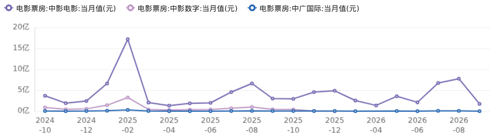

# 影视行业深度研究报告

影视ETF、AI制作与漫剧、区域产业、内容趋势及投资逻辑

研究日期与口径：报告日期待核；引用资料最晚2026-10-22，图表截至2026-09

作者：用户提供原稿（作者未注明）

## 原稿主线：AI重塑生产，IP与渠道决定变现

原稿围绕影视板块估值与资金、AI降本增效和漫剧发展展开，讨论杭州产业布局、博纳影业实践、题材与平台竞争，并梳理影视及AI漫剧产业链标的。以下完整保留原稿观点和引用，不将其中的弹性排序、市场规模预测或推荐结论作为本站已核验判断。

## 1. 行业现状与市场表现

### 1.1 影视板块估值与资金流入趋势

从估值维度观察，影视板块在经历前期调整后，已进入历史相对低位区间。截至相关统计时点，中证影视主题指数PE处于近1年20%分位，历史估值区间为-3167.87至2309.93，当前指数估值水平处于偏低位置[1]。这一估值特征意味着板块对潜在利好的敏感度有所提升，市场情绪一旦回暖，板块具备较强的向上弹性基础。

值得注意的是，资金层面的边际变化与估值低位形成呼应。影视ETF国泰（516620）近期呈现连续上涨态势，已实现连涨4天，近30日资金净流入达2792.55万元，显示出部分资金开始提前布局影视赛道的中长期机会[1]。从更宏观的产业背景来看，2025年中国电影全产业链产值达8172.59亿元，机构预测2024-2026年复合增速约6.2%，行业处于存量结构性分化阶段，具备成熟工业化制片体系与优质IP储备的头部项目增速显著高于行业平均水平[2]。在这一产业格局下，资金流向ETF的行为实质上反映了投资者对板块内优质资产集中配置的偏好。

#### ETF持仓集中度与配置指向

从影视ETF国泰（516620）的成分结构来看，前十大成分股覆盖了影视内容制作与发行渠道的核心企业，包括东方明珠、完美世界、光线传媒、儒意电影、视觉中国、芒果超媒、捷成股份、中国电影、华策影视、江苏有线[1]。这一持仓分布表明，资金通过ETF进入影视板块时，实际配置重点集中在具备内容工业化能力、IP储备深度或渠道优势的头部公司，而非对行业整体的平均覆盖。

上述持仓特征与产业端的K型分化逻辑相吻合：缺少IP储备、项目风控薄弱、粗制滥造的跟风同质化作品毛利持续承压，而具备成熟制片体系、AI虚拟拍摄能力及多渠道发行能力的精品内容项目增速显著高于行业均值[2]。因此，ETF的头部集中持仓本身即构成一种质量筛选机制，其资金净流入所反映的配置行为更具结构性指向意义。

#### 回调后的基本面支撑与修复预期

从盈利端观察，影视院线板块在2025年一季度的实际业绩为估值修复提供了基本支撑。2025Q1影视院线行业实现收入141.2亿元，同比增长41%，总毛利额46.8亿元，同比增长41%，毛利率33.2%与上年同期持平；归母净利润总额达23.7亿元，较2024年同期的13.5亿元显著改善[3]。这一业绩弹性主要受头部影片带动春节档票房与观影人次创历史新高的驱动[3]。尽管板块估值自高位明显回落，但上市公司的盈利修复趋势并未同步中断，形成了“估值下修、业绩改善”的背离格局，这为后续资金持续流入提供了基本面层面的合理性。

同时，从产业长周期变量来看，AI技术对影视制作环节的降本增效预期正在逐步兑现。方正证券相关研究预计2026年影视板块受益于AI技术降本增效的产业变革，行业弹性将呈现“影视＞营销＞传媒指数＞游戏”的排序，影视板块弹性空间突出[4]。这一预期与当前估值的低分位状态相结合，构成了资金在回调期间逆势布局的关键逻辑：在技术周期与内容周期交汇的低估值窗口期，以ETF形式配置板块有望同时获得估值修复与产业升级带来的双重收益。

### 1.2 影视ETF产品与成分股结构

影视ETF国泰（516620）是当前A股市场少数以影视主题为核心投资方向的指数型产品，其跟踪标的为中证影视主题指数。该指数在编制上并非简单覆盖影视制作公司，而是选取影视内容提供商（包括影视制作、网络剧制作和动漫制作等）、发行商、渠道商，以及其他受益于影视发展的上市公司证券作为指数样本，形成对影视产业链的系统性表达[5]。从产品定位看，该ETF的核心逻辑在于将影视行业的投资从“押注单一影片或单一公司”转化为“配置行业整体复苏与升级趋势”，通过一篮子标的分散项目周期波动带来的个股风险[6]。

#### 前十大成分股构成

中证影视主题指数的前十大成分股覆盖了影视产业链上中下游的关键节点，截至2026年10月的数据显示，其构成与权重分布如下[5][7]：

| 序号 | 成分股名称 | 产业链环节 |
| --- | --- | --- |
| 1 | 东方明珠 | 渠道分发/新媒体平台 |
| 2 | 完美世界 | 内容制作/游戏影游联动 |
| 3 | 光线传媒 | 内容制作/动画电影 |
| 4 | 儒意电影 | 内容制作/发行 |
| 5 | 视觉中国 | 版权内容/视觉素材 |
| 6 | 芒果超媒 | 平台运营/内容制作 |
| 7 | 捷成股份 | 影视制作/版权运营 |
| 8 | 中国电影 | 发行/院线/制作 |
| 9 | 华策影视 | 剧集内容制作 |
| 10 | 江苏有线 | 渠道分发/广电网络 |

表格内容来源于2026年10月每日经济新闻相关报道及其引用的ifind指数成分股数据[5][7]。

#### 成分股结构的产业链覆盖逻辑

从上述成分股构成可以清晰看出，该指数的设计思路并非偏重某一单一环节，而是追求全产业链暴露。在上游内容制作端，光线传媒、华策影视、完美世界、儒意电影分别代表动画电影、剧集制作、影游联动和电影出品发行等细分方向；在中游发行与版权运营环节，中国电影、捷成股份、视觉中国承担了电影发行、影视版权运营和视觉内容版权交易的功能；在下游渠道与平台端，东方明珠、芒果超媒、江苏有线则覆盖了新媒体平台、广电网络和内容播出渠道[5]。这种“制作—发行—渠道”的三层分布结构，使得指数能够在行业景气回升时捕捉到各环节的系统性收益，而非局限于某一节点的弹性[6]。

全产业链覆盖的核心价值在于风险的截面分散。 影视行业具有典型的项目制特征，单一影片或剧集的成败可能导致相关公司季度利润出现剧烈波动，而ETF通过持有多环节、多公司的一篮子组合，将投资逻辑从“赌爆款”降维为“赌行业趋势”，这种资产组合逻辑在影视这类高波动性行业中具有明显的配置优势[6]。

#### 估值与资金面的产品特征

从估值维度看，中证影视主题指数的市盈率（PE）在2026年10月处于近1年20%分位，属于偏低水平，这意味着影视板块整体估值尚未充分反映行业基本面改善的预期[7]。与之对应的是资金面出现的边际变化：影视ETF国泰（516620）在截至2026年10月22日的近20个交易日内累计“吸金”1.12亿元，表明部分资金在估值低位开始布局影视主题资产[5]。同期，华宝证券ETF生态周报数据显示，影视ETF国泰的换手率达到217.5%，周成交额为6.1亿元，但需注意该产品整体成交规模在高换手ETF中仍相对有限[8]。

AI技术演进与IP价值重构为成分股提供了新的重估逻辑。 在消费级AI Agent产品形态和用户价值跃迁的背景下，影视内容制作、发行渠道及IP变现模式均面临价值重估的可能[7]。具体到成分股层面，华策影视已布局算力扩产与全AI精品短剧，光线传媒通过《哪吒之魔童闹海》验证了IP衍生变现的庞大空间，而中国电影、儒意电影等则直接受益于AI对制作环节的降本增效[4][9][10]。这些基本面变化为中证影视主题指数的成分股提供了超越单纯票房周期波动的成长驱动因素。

## 2. 技术驱动：AI重塑影视产业链

### 2.1 AI降低制作成本与提升生产效率

AI 技术对影视行业最直接的重塑，首先体现在生产环节的成本压缩与效率跃升。华泰证券研报指出，短期看，AI 有望通过场景生成、视效制作及后期加工降低制作成本、提升项目效率；中长期看，规模化生产与跨语言内容开发有望拓宽 IP 商业化边界，催生 AI 原生内容及制作技术服务等新模式[11]。这一判断与国金证券对内容生产链条“从人力密集型推向工具驱动型”的判断相互印证——制作门槛下降后创作者与作品数量同步增长，内容供给端出现结构性扩张[12]。

#### 制作成本的多环节压缩

AI 对成本的压缩并非单一环节的改良，而是覆盖影视生产全链路。中金公司对 AI 赋能影视生产全链路的提效路径进行了系统测算：

- 前期筹备：AI 场景概念与动态预演将历史剧美术筹备周期从数月缩短至数周，开机前可视化预演大幅减少片场现场返工，直击行业试错成本与沟通成本两大痛点[13]。
- 中期制作：作为制作端 70%–80% 成本承载环节，AI 降本空间最为可观。其中虚拟拍摄基地可削减约 85% 场景搭建成本，数字人演员降低建模原画成本约 80%，特效制作周期最高缩短 40% [13]。
- 后期与发行：AI 在宣传物料生成与翻译出海方面具有明显提效作用，进一步压缩了长尾环节的资金占用与人力投入[13]。

上述数据表明，AI 对影视制造成本的削减幅度在多个关键环节已达到 40%–85% 区间，与“特效制作成本降低 70%–80%”的产业观察方向一致。华泰证券进一步指出，具备优质 IP 储备、成熟制片体系与发行渠道的影视公司，有望率先将技术进步转化为内容产能与经营效率提升[14]。

#### 生产周期从“月级”向“周级”“日级”压缩

传统影视项目从立项到交付往往以月甚至季度为单位，而 AI 工具的介入正在将这一周期大幅压缩。方正证券研报显示，AI 漫剧制作成本较真人短剧大幅下降，生产周期由月级压缩至周级，人力与时间成本显著优化，全民创作时代正在到来[4]。爱奇艺在 2026 秋季悦享会上也表示，AI 已推动短剧爆发式增长，并将缩短长视频的制作周期[12]。

更具标志性的案例来自新华社报道：动画电影《一掌熊猫》包含大量未来科技场景与激烈打斗，传统实拍需搭建实景影棚、雇用大批群演，启动资金动辄数百万元，而创作团队借助 AI 仅耗时 28 天、花费 3 万元便完成制作。该片导演用“过去影视创作是‘大兵团作战’，现在是‘一人一部门，AI 作支撑’”概括了这一转变[15]。这一案例直观勾勒出 AI 将生产周期从“月级”“年级”压缩至“周级”甚至接近“日级”的产业现实。

#### 供给端繁荣与工业化能力沉淀

制作门槛的下降直接带来内容供给端的结构性扩张。国金证券指出，AI 生成与 AI 仿真人技术让单位内容的制作成本下降，创作者与作品数量随之增长；DataEye 数据显示，2026 年上半年国内 AI 短剧市场规模突破 220 亿元，全年有望冲击 400 亿元，AI 短剧用户突破 6 亿[12]。方正证券亦观察到，2025 年成为 AI 漫产业元年，行业仅用一年走完传统短剧五年发展路径，市场规模飙升至近 200 亿元，2026 年有望增至 220 亿元，正式进入规模扩容与质量升级并行的高景气周期[4]。

更值得注意的是，AI 带来的并非单纯的成本削减，而是可复用的工业化能力。央视财经报道指出，在北美部分动作类微短剧中，AI 全流程辅助已将制作周期压缩至三至四周，成本控制在 6 万美元以内；AI 赋能影视带来的不只是更高效的制作流程，更是可复用的工业化能力[16]。中金公司从长期视角提出，AI 从提升内容成功率、压缩制作成本、加快资金周转三大维度有望改善行业 ROI，长期重塑产业链价值分配[13]。这意味着，降本提效的最终指向并非单纯的“更便宜”，而是影视生产从单项目制向标准化、规模化生产演进的结构性变革[14]。

### 2.2 AI漫剧兴起与全链路生产重构

#### AI漫剧元年：从技术验证到产能释放

2025年被业界视为 AI漫剧产业元年，行业仅用一年时间走完了传统短剧五年才完成的发展路径，市场规模快速攀升至近200亿元[4]。从播放量口径观察，2023年以前国内AI漫剧市场年播放量仅约3亿，到2025年已跃升至757亿以上，实现约250倍的增长；2026年抖音端原生AI漫剧月播放量更从1月的154亿攀升至6月的1557亿，半年内翻了十倍[17]。国金证券援引DataEye数据显示，2026年上半年国内AI短剧市场规模已突破220亿元，AI短剧用户规模突破6亿[12]。

产能端的爆发同样显著：

- 供给数量跨越式增长：2026年1月AI漫剧新剧上线1.96万部，是真人剧（4221部）的4倍以上；至3月达到上半年峰值4.67万部，为同期真人剧（3613部）的十多倍[17]。
- 生产节奏大幅压缩：AI漫剧制作周期由月级压缩至周级，人力与时间成本显著优化，全民创作时代正在到来[4]。
- 市场规模持续扩容：行业预测AI漫剧市场规模2026年预计达到400亿元，2030年有望增长至850亿元，接近千亿量级[17]。

#### 生成式视频模型迭代与产业痛点突破

AI生成视频大模型的技术突破是推动AI漫剧从实验走向规模化的核心动力。2025至2026年间，Seedance 2.0、可灵3.0、Vidu Q3等视频大模型持续迭代，在原生多镜头叙事、音画同步、高清输出、角色一致性优化等方面实现显著升级，有效解决了跨镜头变脸、风格漂移等行业长期存在的技术痛点[4][18]。

- 角色动作稳定性提升：部分平台的“首尾帧生视频”功能，以指定首帧和尾帧的方式约束生成过程，解决了AI角色动作不稳定的核心痛点[19]。
- 画质与效率的同步跃迁：AI漫剧已步入“全流程原生阶段”，画质接近影视级，制作效率较传统动漫提升90%以上[17]。
- 中长期内容形态升级：长视频领域强调“工业化升级”，利用AI压缩制作周期、优化前期预演与后期渲染；短视频领域则呈现“全维度创新”，AI漫剧与AI仿真人剧持续放量[18]。

#### 全链路生产重构：五步工业化流程

AI技术的深度介入改写了漫剧的生产逻辑，形成“创意输入—AI生成—人工优化”的 五步工业化革命，全流程AI参与度稳定在70%至80% [19]。具体流程如下：

1. 剧本创作：大语言模型根据关键词快速生成初稿，可将网文IP在数小时内转化为保留“爽点”的脚本，传统数周工作量被大幅压缩[19]。

2. 分镜设计：输入剧本即可自动输出4K分辨率画面，支持武侠国漫等风格化渲染，并可实时调整细节，降低传统分镜的成本与耗时[19]。

3. 分镜视频生成：依托图生、文生视频模型，结合首尾帧约束实现角色动作的稳定性控制[19]。

4. 配音及音效：AI支持多音色情感演绎，自动匹配BGM与剧情节点音效，一键切换方言或外语的能力也直接服务于出海场景[19]。

5. 后期剪辑：AI自动拆镜、卡点音效，并修复画面闪烁、变形等问题，剪辑效率成倍提升[19]。

降本效果方面，漫剧单分钟制作成本从传统的2000—5000元降至1000—2500元，部分剧集成本仅为传统模式的十分之一，制作周期缩短50%—80% [19]。以中文在线为例，其自研“逍遥”大模型支持14种语言创作，2025年翻译成本下降90%、内容生产效率提升40%；“次元神笔”全栈式AI创作平台将制作环节从11步压缩至3步（剧本→素材→合成），3D动画单分钟制作成本下降超过75% [4]。

#### AI仿真人剧：从边缘到主流的内容形态演变

在AI漫剧内部，AI仿真人剧的快速崛起构成了最具标志性的结构性变化。2026年1月，AI仿真人剧在新剧中的占比尚不足20%；到3月该比例跃升至60%以上，6月进一步达到70%，半年内从辅助形态演变为“绝对主流”[17]。这一变化反映出技术成熟度提升后，市场对更具真实感与沉浸感的AI剧集形态的偏好迁移，同时也意味着AI仿真人剧正成为平台流量与上新主力[4]。

#### 产业链格局与企业卡位

AI漫剧已形成 网文IP—技术工具—内容制作—平台分发—全球化出海 的完整产业闭环，头部公司依托IP储备、模型能力、生态资源形成差异化壁垒[4]。

| 产业链环节 | 代表企业 | 核心优势 |
| --- | --- | --- |
| 网文IP端 | 中文在线、阅文、掌阅 | 网文IP高效改编为漫剧脚本 |
| AI工具与工业化平台 | 万兴科技、捷成股份 | AI工具与工业化生产平台 |
| 影视IP切入赛道 | 欢瑞世纪、博纳影业、华策影视 | 依托影视IP资源切入AI短剧 |
| 海外市场领跑 | 昆仑万维 | 领跑海外AI漫剧市场，收入与流水高速增长 |
| 跨界算力布局 | 德才股份 | 算力+AI漫剧双轮布局卡位字节生态 |

表格内容综合自方正证券2026年5月发布的研报及智通财经相关报道[4][18]。

#### 合规约束与精品化方向

技术狂奔之下，监管同步进化。2026年7月发布的《微短剧发展管理办法》规定，自2026年9月1日起，AI生成内容须进行显著标识，落实总编辑负责制，并建立重点账号信用评价体系，AI标识与分级备案上升为部门规章法规层级，合规能力从“加分项”变为“入场券”[17]。与此同时，低质AI短剧的泛滥正在倒逼平台提高内容审核标准，同质化竞争下大量低质作品被平台清退，分账门槛持续抬升[20]。在“红线划定+正向引导”的监管框架下，精品化已成为行业明确的演进方向，AI漫剧从“有无”之争进入“优劣”之辨的新阶段[17]。

## 3. 产业布局与区域发展

### 3.1 杭州‘AI+电影’培育项目与临平产业转型

杭州市在推动“AI+电影”融合创新方面率先形成政策抓手。2026年10月，杭州正式发布首批杭产“AI+电影”培育项目名单，共有10个项目入选，其中院线电影5部、网络故事片5部[21]。该名单由杭州市委宣传部联合中国美术学院电影学院、浙江传媒学院华策电影学院、杭州市电影电视家协会共同推出，旨在发挥杭州人工智能技术与影视产业集聚优势，鼓励影视企业探索应用AI生产解决方案，推动人工智能与影视精品创作深度融合[21]。从项目类型看，首批入选项目涵盖科幻、悬疑、历史、奇幻等多元题材，既有对杭州历史文化资源的创新演绎，也有面向未来的科技想象，如南宋临安悬疑探案、机器人横穿南美洲的科幻旅程、脑机接口技术赋能的未来杭州等，展现出“AI+电影”融合创作的多元可能[21]。

#### 临平区入选项目与企业实践

临平区在首批杭产“AI+电影”培育项目中占据一席。根据临平区门户网站信息，区内企业享映视界打造的AI原创网剧《如果·AI》入选首批培育项目名单[22]。该案例的核心突破在于 AI制作高质量特效的成本较好莱坞特效大片下降了七八成，且效果毫不逊色，使AI电影从概念走向可复制的生产实践[22]。效率与成本的双重突破，体现了AI技术在影视制作环节的商业化落地能力，也为临平区影视企业探索“AI+内容生产”提供了可参照的样本。

#### 临平影视产业转型路径

享映视界的探索是临平影视产业转型升级的缩影。临平区近年来通过 “精品打造+人才培养”双轮驱动，以政策扶持、平台搭建、资源整合等举措，推动影视创作从“流量导向”向“价值引领”升级[22]。在产业要素支撑方面，2026年1月临平举办杭州“AI+微短剧”产业发展大会，致力于推动AI技术融入微短剧生产、发行、出海全流程，探索构建 “平台、基金、政策、活动、配套”五位一体的产业要素支撑体系 [22]。这一体系覆盖了从基础设施到资本支持、从政策激励到活动交流、从配套服务到平台分发的完整产业培育链条。

在人工智能加速融入内容生产的背景下，临平正进一步发挥文化资源、技术创新和影视产业集聚的三重优势，推动影视创作与科技应用双向融合[22]。从区域产业布局角度看，临平的路径并非单纯追求影视项目数量增长，而是 以AI技术应用为切口，将区域既有的数字技术基础与文化内容生产能力进行耦合，形成差异化的“AI+影视”产业集群特征。未来，临平将持续完善项目培育机制，拓展交流展示平台，推动更多“AI+影视”创新成果落地转化，为杭产影视精品创作和产业高质量发展注入新动能[22]。

#### 区域政策延续性与行业背景

杭州对“AI+电影”培育项目的推动具有政策延续性。杭州市层面明确表示，未来将建立 常态化项目培育和名单发布机制，持续推动AI技术赋能影视产业高质量发展[21]。这一制度安排意味着“AI+电影”扶持政策不是一次性项目评选，而是构建长期稳定的区域产业政策框架。从更宏观的产业背景看，政策引导与市场驱动的双重作用下，影视产业格局将持续优化，技术赋能效应进一步凸显[23]。临平区在这一趋势下，将区域影视产业转型的着力点置于AI技术与内容创作的深度融合，契合了行业从“流量驱动”向“内容为王”转型的整体方向，也为区域影视产业在“十五五”期间的高质量发展提供了持续的政策与企业实践支撑[22][23]。

### 3.2 企业AI战略布局案例：博纳影业

博纳影业在AI影视领域的布局经历了从内部技术试验到独立市场化运营的关键跃迁。2023年底，公司成立AIGMS（AI Generated Movie/Series）制作中心，将生成式AI技术引入影视生产流程[24]。2025年7月，博纳影业将该中心正式升级为独立运营的全资子公司——博越星纪蓝图（成都）影视科技有限公司，标志着其AI业务从“内部孵化”转向“市场化独立运作”[24][25]。这一组织架构调整的核心逻辑在于：将AI能力从成本中心转化为可对外输出的业务单元，同时保持与母公司内容生态的深度协同。

#### 博越星纪蓝图的业务架构

升级后的博越星纪蓝图以“完整电影工业化体系+生成式AI技术”双重能力为核心定位，构建了四大业务板块[24]：

- 短剧制作：以AI辅助生产方式批量生产高质量短剧内容
- IP电影开发：依托博纳自有IP储备，推进AI生成式电影的开发与制作
- 影视垂直模型：面向影视行业的专用AI模型研发与训练
- 电影前后期技术解决方案：向行业输出AI赋能的制作工具与服务

四大板块共同构成“内容+IP+工具+方案”的融合布局，使博越星纪蓝图既具备内容出品能力，也具备向行业输出技术能力的平台属性[25]。

#### 三星堆IP的AI影视化实践

博纳影业AI战略最显著的落地成果集中在三星堆IP的系列化开发上。公司出品的国内首部AIGC生成式科幻短剧集《三星堆：未来启示录》在抖音上线后，全网累计播放量超过2亿次，上线当日跻身抖音短剧最热榜第二名[24][26]。该剧采用纯AIGC生成式连续性叙事方式，在场景、人物、道具等方面应用了十几种AIGC视频技术，并利用大语言模型进行AI创意开发[26]。其国际影响力同样值得关注：该剧获得美国电影艺术节“美国电影艺术奖金奖”及法国戛纳世界电影节最佳剧情片单元特别提及奖[24]。

在此基础上，博纳影业进一步将三星堆IP延伸至院线电影领域。首部AI院线长片《三星堆：未来往事》已正式定档，由博纳AIGMS团队依托自研的“博卡电影云片场”完成全链路AI辅助创作[25]。这一作品被视为AI影视从“概念验证”走向“产业落地”的标志性事件，其市场表现将成为检验AI长片商业化可行性的重要参考[27]。

#### 财务现实与战略耐心

从财务数据看，博纳影业的AI业务仍处于早期投入阶段。2026年上半年，公司实现营业收入4.58亿元，同比下降31.9%；归母净利润亏损1.69亿元，同比减亏84% [24]。其中，AI影视剧业务营业收入为193.23万元，仅占公司整体营业收入的0.42% [24]。这一数据揭示了一个重要事实：AI影视的产业化尚处萌芽期，其短期财务贡献有限，战略价值更多体现在中长期能力构建上。与此同时，公司通过持续投资好莱坞项目（如与TSG合作获得《阿凡达3》等影片投资收益权）维持海外收入基本盘，上半年海外板块收入达1.59亿元，为AI业务的持续投入提供了资金缓冲[28]。

#### 产业链定位与竞争视角

从产业链格局看，方正证券研报将博纳影业归入“依托影视IP切入AI短剧赛道”的企业阵营，与欢瑞世纪、华策影视同列[4]。博纳的差异化优势在于：其拥有成熟的院线电影工业化体系，将传统电影制作能力与生成式AI技术结合，形成了一条从AI短剧（市场验证）到AI长片（产业升级）的递进式路径[26]。这种“三步走”模式——从AIGC生成式短剧集，到“AI+实拍长剧集”，再到“AI+工业化电影”——为公司提供了相对清晰的AI技术商业化节奏[26]。

表格内容来源于2026年10月北京商报报道及华泰证券研报[24][26]。

## 4. 内容趋势与平台竞争

### 4.1 2025-2026年影视剧题材发展趋势

从平台待播剧集储备结构来看，2025-2026年影视剧市场在总盘稳定的前提下，正加速向细分类型创新与高质量叙事方向演进。大盘不再依赖单一爆款类型的“押注式”供给，而是通过悬疑、她题材、男频、严肃文学改编等多条赛道并行，寻求差异化突破[29]。这一趋势背后，是观众审美升级与供给端结构性错位的持续倒逼：高口碑作品未必能完全转化为票房或播放量，单纯堆砌流量元素的模式正在失效，内容端必须回归剧本质量、类型融合与本土化表达[30]。

#### 红海赛道：悬疑与她题材竞争加剧，创新空间收窄

悬疑题材已进入供给密集、同质化风险较高的阶段。 各平台待播剧集中，现代悬疑的储备量最大，以犯罪、缉凶、刑侦为主要背景的作品扎堆；与此同时，“悬疑+”成为主要突围手段，即把悬疑元素融入都市、家庭、职场、爱情等多元化题材中，试图在现实人性和社会问题的探讨中寻找内容增量[29]。这意味着，单纯的案件推理已难以支撑差异化，悬疑赛道的竞争正从“案件奇观”转向“社会议题深度”。

她题材同样面临红海化压力。 女性向剧集在经历数年的高速供给后，题材红利边际递减，市场对“标签化女性叙事”的耐受度提高，要求创作者在代际沟通、性别平等、心理健康等当代议题上做更深层开掘，而非停留在表面人设与情感冲突[31]。高口碑未充分转化为商业回报的现象在这一赛道中尤为突出，倒逼制片方从“项目制”思维转向IP长线运营与精细化内容打磨[30]。

#### 蓝海赛道：男频剧集与严肃文学IP改编释放增量

男频IP改编剧集是当前储备较大但资源尚未充分释放的方向。 大男主叙事、人物传奇等类型在长剧市场中的供给长期不足，与男频网文庞大的读者基础形成错配。平台已开始将男频IP作为增量布局重点，但其转化难点在于如何平衡原著爽感与影视叙事的完整性，单纯依赖特效堆叠或流量演员的模式难以持续，需要更扎实的剧本改编能力[29]。

IP改编的选材逻辑正从虚构小说、通俗文学向严肃文学、历史小说迁移。 古装长剧的创作方向由“架空设定”转向宏大历史背景下的成长性叙事，在人物塑造和历史质感上寻求差异化；改编源头的升维，使剧集在思想深度、社会价值与长尾传播上具备更强竞争力，也更契合政策端对高质量长剧集创作的鼓励方向[9][29]。这一转型与行业整体从“能否引爆热度”向“能否经得起时间检验”的共识转向是一致的——历史题材注重考据严谨与精神内核提炼，科幻作品强调科学逻辑与人文关怀结合，均反映出内容评价体系的根本性迁移[31]。

#### 类型多元化：从少数垄断走向生态繁荣

市场不再由古偶、甜宠等少数类型长期垄断。年代剧、行业剧、动画、纪录片、戏曲影视化等细分领域均获得稳定发展窗口，多元共生的内容生态既满足不同圈层需求，也增强了行业整体的抗周期能力[31]。在电影端，动画电影凭借东方美学与技术创新的结合已形成独特风格，在头部内容中占据显著位置；互动影游则以低成本、高回报的特性持续涌现黑马，验证了内容形态跨界融合的可行性[32]。

#### AI题材突破：技术赋能下的新内容形态

AI技术正在从生产工具层面影响题材选择边界。2026年一季度，AI仿真人剧在AI短剧赛道中占比达55%，以近750亿的总播放量领跑，其核心价值在于补上了真人短剧长期缺失的玄幻、科幻、仙侠、末日等强特效赛道 [4]。这意味着，曾因制作成本与工业化门槛而被长剧市场边缘化的高概念题材，有望通过AI生产工具的普及重新进入内容供给视野，部分验证成功的角色与世界观还可通过“IP资产经营”模式向长剧、电影、游戏等更高投入形态延伸[33]。

#### 内容创新逻辑总结

综合来看，2025-2026年影视剧题材趋势的核心矛盾并非“缺内容”，而是“缺有效差异化供给”。红海赛道的竞争焦点从题材本身转向叙事深度与议题价值；蓝海赛道的机会来自男频IP的系统性开发与严肃文学改编的品质升维；而AI技术带来的题材突破尚处于验证期，其能否沉淀为可持续的IP资产，取决于平台与制片方能否建立“低成本内容验证—动态调校—跨媒介放大”的运营闭环[29][33]。在“十五五”规划临近的背景下，内容价值与商业价值的平衡能力，将成为决定影视企业下一阶段竞争力的关键变量[23]。

### 4.2 新兴影视平台与用户需求变化

在当前影视行业竞争格局中，除头部院线与头部流媒体平台外，一批定位垂直化、运营数据化的新兴网络影视平台正在崛起，其发展路径折射出用户需求从“被动观看”向“主动选择”、从“大众内容”向“个性化内容”的深层迁移。以菠萝影院、国产木瓜影院等为代表的网络影视新势力，凭借差异化定位与内容深耕策略，在细分市场中形成独特竞争优势。

#### 新兴平台的差异化定位逻辑

国产木瓜影院聚焦垂直领域深耕，以国产影片为核心构建专属观影空间。据平台公开统计，其国产影片播放量占比高达80%，这意味着平台内容供给与用户偏好高度匹配，形成“以国产内容吸引特定圈层、以圈层粘性反哺平台运营”的闭环[34]。相比之下，菠萝影院则更强调以大数据分析驱动内容推荐，通过用户行为数据精准匹配观影需求，实现平台与用户之间的高效连接[34]。

这种“垂直深耕+数据驱动”的差异化路径，与主流流媒体平台的泛内容扩张形成区隔。爱奇艺、腾讯视频等头部平台以“自制剧+分账剧”模式吸引年轻用户，覆盖大基数人群；而新兴平台则选择在细分内容方向建立壁垒，在用户时间争夺战中寻求错位生存空间[35]。

#### 用户需求变化的核心特征

新兴平台的实践反映出用户对影视内容的偏好正在发生三个维度的变化。

其一，海量内容与便捷触达的并存需求。 用户希望平台具备足够丰富的影视资源库，以获得更多自主选择空间；新兴平台通过整合内容资源，降低用户的搜索成本与决策门槛，满足“即点即看”的消费习惯[34]。

其二，独家内容与个性化推荐的偏好强化。 平台竞争焦点正从“有没有内容”转向“有没有用户想看的独有内容”。数据驱动下的个性化推荐机制，不仅提高了内容分发效率，也增强了用户对平台的依赖度。新兴平台在垂直领域的深耕，本质上是在构建一种“独家感”——通过内容结构差异形成不可替代性[34]。

其三，互动式观影体验的兴起。 随着互联网技术成熟，用户不再满足于单向观看，互动元素逐步成为平台提升用户留存的新方向。部分新兴平台已尝试在观影过程中引入互动设计，将用户体验从“观看内容”延伸至“参与内容”，这成为平台争夺年轻用户注意力的重要手段[34]。

#### 平台竞争的生态化延伸

新兴平台的崛起也推动影视行业竞争从单一内容维度向生态化运营延伸。流媒体平台将内容资源加速向高价值用户倾斜，通过“权益礼包”“SVIP提前看”“锁集”等排播策略，引导用户向高付费层级迁移[36]。这一趋势与新兴平台的逻辑一脉相承：平台竞争的核心已从单纯用户规模扩张，转向对用户生命周期价值与内容付费意愿的深度挖掘。

长视频平台同样呈现“和而不同”的竞争格局：优酷以大体量片单稳固基本盘并尝试出海，爱奇艺在历史正剧和革命题材上集中投入，腾讯视频全赛道均衡发力，芒果TV固守青春偶像的差异化阵地。各大平台不再追求“赢家通吃”，而是在各自具备优势的赛道加重砝码[37]。这种策略重心分化，为新兴垂直平台提供了继续生长的产业缝隙。

新兴影视平台的实践表明，用户需求变化正推动行业从“供给主导”向“需求分层”演进。海量、便捷、独家、互动四个关键词所代表的需求特征，不仅塑造了新兴平台的产品逻辑，也对传统影视企业的内容策略与用户运营体系构成持续性压力[34][35]。

## 5. 投资逻辑与标的建议

### 5.1 AI赋能下的投资弹性排序

从板块比较视角看，2026年传媒各细分赛道的弹性预期已出现明显分化。方正证券判断，2026年行业弹性将呈现“影视＞营销＞传媒指数＞游戏”的排序，其核心逻辑在于影视板块经历了最为彻底的供给出清，叠加AI技术对制作成本的实质性压缩，向上修复空间最为突出[4][38]。游戏板块虽为现金流基本盘，但其业绩弹性释放节奏相对平稳；营销板块受益于AI落地提速，成长弹性次之；而影视板块兼具“低位估值+成本改善+内容形式革新”三重驱动，成为弹性排序中的首要方向[39]。

#### 弹性排序的核心依据：行业出清与AI降本增效共振

影视板块之所以被置于弹性首位，首先源于其供给端格局的深度优化。2023年以来，影视行业经历“供给收缩、需求复苏、质量提升”的高质量发展转型期，行业出清基本完成，头部效应显著增强，留下具备内容工业化能力和IP储备优势的玩家[9]。在这一基础上，AI技术的介入并非单纯的概念催化，而是直接作用于成本结构与生产效率，为利润弹性提供了可量化的释放空间。

从中金公司的测算来看，AI对影视制作端的降本路径已覆盖全链路：

- 前期环节：AI场景概念设计与动态预演将历史剧美术筹备周期从数月缩短至数周，开机前可视化预演显著降低片场返工率[40]；
- 中期环节：作为制作端70%~80%成本承载的核心环节，AI的降本空间最为可观——虚拟拍摄基地可削减85%场景搭建成本，数字人演员降低建模原画成本约80%，特效制作周期最高缩短40% [40]；
- 后期环节：宣传物料生成与翻译出海方面亦有明显提效，进一步压缩边际成本[40]。

从投资角度理解，AI降本直接作用于利润率与资金周转效率。影视项目制作周期长、前期投入大，成本压缩意味着同等投入下可覆盖更多项目、缩短回收周期，从而在营收持稳的前提下放大利润弹性。方正证券在中期策略纪要中明确指出，影视板块出清最为彻底，且正处于AI技术降本增效的产业变革窗口，因而其弹性空间在传媒各子板块中相对突出[38]。

#### AI漫剧：弹性排序中确定性最高的细分方向

在影视板块内部，AI漫剧被多家机构视为“技术适配性强+IP变现路径清晰”的重点方向 [4]。相较于传统影视制作，AI漫剧的工业化程度更高，从网文IP改编到画面生成、配音合成，全链路均可由AI工具辅助完成，对传统制作资源的依赖度较低，边际成本曲线更陡峭。

产业链格局已形成相对清晰的闭环，各环节的头部玩家分工明确：

| 产业链环节 | 核心玩家 | 差异化优势 |
| --- | --- | --- |
| 网文IP供给 | 中文在线、阅文集团、掌阅科技 | 依托网文IP储备实现漫剧高效改编 |
| 技术工具与平台 | 万兴科技、捷成股份 | AI工具与工业化生产平台 |
| 影视IP切入短剧 | 欢瑞世纪、博纳影业、华策影视 | 依托既有影视IP资源向短剧赛道延伸 |
| 海外AI漫剧市场 | 昆仑万维 | 海外AI漫剧收入与流水高速增长，领跑市场 |
| 跨界算力+AI漫剧 | 德才股份等 | 以算力布局叠加AI漫剧，卡位字节生态 |

表格内容来源于方正证券2026年5月25日发布的研报《影视&AI短剧深度梳理：2026 AI对影视行业的重塑》[4]。

AI漫剧的变现方式呈现多元化特征，包括平台分账、内容付费、品牌植入、电商直播等，这一方面拓宽了单项目的收入来源，另一方面也对入局方的综合变现能力提出了更高要求[4]。方正证券由此倾向看好具备内容制作能力与突出变现能力的平台型公司，而非仅停留在技术工具层面的单一环节参与者[4]。

#### 弹性排序下的投资标的层级

基于“影视＞营销＞传媒指数＞游戏”的弹性判断，投资标的选择应围绕弹性最高的影视板块展开，并在板块内部分层配置：

- 传统影视标的（AI赋能降本增效逻辑）：方正证券建议重点关注儒意电影、上海电影、中国电影、光线传媒，这些标的是板块内市值居前、IP储备与内容工业化能力较强的代表性企业，受益于AI技术在传统影视制作全链路的渗透[4]。其中光线传媒被视为板块龙头，以影视领域广泛业务与爆款IP构成“一超多强”格局的核心[38]。
- AI漫剧概念标的（技术适配+IP变现逻辑）：包括中文在线、昆仑万维、荣信文化、阅文集团、掌阅科技、万兴科技、欢瑞世纪、博纳影业、华策影视、捷成股份等，覆盖从IP供给、技术工具到内容制作与出海的完整链条[4]。
- 弹性博弈的仓位原则：对于普通投资者而言，传媒板块的配置可采取“稳健为主、少量博弈”的思路——游戏与AI营销优质标的作为稳定配置的底仓，影视弹性标的则以较轻仓位参与，避免追逐缺乏实质业绩支撑的题材型小票[39]。

从估值维度看，影视板块当前整体处于历史偏低区间，“泡沫充分出清”为其弹性释放提供了安全边际支撑[39]。2026年作为AI应用大年，影视板块的弹性不仅来自AI对成本端的直接改善，也来自市场对AI原生内容形态（如AI漫剧）商业化路径的重新定价。在这一框架下，弹性排序所指向的投资含义是：优先配置影视板块中具备AI落地场景与清晰变现路径的标的，其次再考虑营销等中间弹性品种，而游戏板块则扮演组合中的稳定性角色[4][39]。

### 5.2 重点推荐企业与产业链分布

基于方正证券的产业梳理，当前影视板块的投资主线可归纳为两条：影视内容龙头受益于AI降本增效带来的业绩弹性，以及AI漫剧赛道凭借“技术适配性强+IP变现路径清晰”形成独立高增长逻辑 [4]。行业弹性排序预计呈现“影视＞营销＞传媒指数＞游戏”的特征，影视板块在2026年AI应用大年中具备显著相对优势[4]。

#### 影视类重点标的：内容工业化与头部IP壁垒

方正证券建议重点关注的影视类标的主要包括儒意电影、上海电影、中国电影、光线传媒，其共同特征是具备头部内容制作能力、院线或发行渠道资源，以及可持续开发的IP储备，能够在AI技术重构长视频生产流程的过程中率先受益于成本优化与产能扩张[4]。

- 中国电影：作为国有电影龙头企业，在发行环节掌握核心渠道资源，同时深度参与重点影片出品。宏观数据亦显示其旗下中影电影、中影数字、中广国际三条业务线持续贡献票房收入，2026年9月合计实现票房约1.93亿元，表明其发行业务基本盘保持稳定运转[41]。
- 光线传媒：长期深耕动画电影赛道，在AI文生视频技术赋能动画制作效率提升的背景下，其动画IP储备与工业化制作能力构成差异化竞争优势[4]。
- 儒意电影与上海电影：分别凭借内容出品能力、IP运营及院线资产，在影视板块整体弹性释放的过程中被方正证券纳入重点推荐组合[4]。

#### AI漫剧概念类标的：IP、技术与平台的全链路卡位

AI漫剧是2025年以来快速崛起的新兴赛道，制作成本较真人短剧大幅下降，生产周期由月级压缩至周级，AI仿真人漫剧已成为平台流量与上新主力，结构性机会突出[18]。方正证券据此梳理出AI漫剧概念的重点标的，分布在产业链不同环节[4]：

| 竞争壁垒类型 | 代表企业 | 核心逻辑 |
| --- | --- | --- |
| 网文IP优势 | 中文在线、阅文集团、掌阅科技 | 凭借自有网文IP储备实现漫剧高效改编 |
| 技术工具与工业化平台 | 万兴科技、捷成股份 | 主打AI工具与工业化生产平台 |
| 海外市场领先 | 昆仑万维 | 领跑海外AI漫剧市场，收入与流水高速增长 |
| 影视IP切入AI短剧 | 欢瑞世纪、博纳影业、华策影视 | 依托既有影视IP资源切入AI短剧赛道 |
| 跨界算力布局 | 德才股份 | 以算力+AI漫剧双轮布局卡位字节生态 |

表格内容综合整理自方正证券发布的影视&AI短剧深度梳理报告[4]。

#### 华策影视：算力与AI短剧双轮驱动的重点案例

华策影视在上述分类中兼具影视内容龙头与AI漫剧概念标的的双重属性。东北证券深度研报显示，公司长期保持剧集行业龙头地位，当前已形成以电视剧、电影内容为核心，覆盖动漫、短剧、艺人经纪及算力业务的综合布局[9]。在AI短剧层面，公司全AI精品短剧即将上线；在算力层面，拟采购不超过33亿元服务器用于已签约客户的算力云服务，算力扩产至3.7万PFLOPS，2025年算力服务业务毛利率高于综合毛利率，扩产后有望带动整体盈利结构改善[9]。这一“内容IP+算力基础设施”的协同模式，体现了头部影视公司在AI浪潮中向产业链上游延伸的战略路径。

#### 产业链分布特征

从整体产业链视角看，网文IP、技术工具、内容制作、平台分发、全球化出海已形成完整闭环，头部公司依托IP储备、模型能力与生态资源构筑差异化壁垒[4]。与此同时，票房资源向极少数头部影片集中的趋势加剧，电影市场的结构性分化使得能否锁定头部内容公司成为投资成败的关键变量 [42]。在政策端，2025年8月广电总局“21条”新政系统性解除供给约束，叠加财政部提前下达电影专项资金，为上述标的内容产能的释放提供了政策基础[43]。

## 数据图表

#### 2024-10至2026-09的宏观数据（月）

2024-10至2026-09的宏观数据（月）

原稿嵌入图，资料来源：Choice金融终端。仅恢复原图，不从曲线反推数值；点击查看原尺寸。

资料来源: Choice金融终端

## 原稿参考来源（完整43条）

按原稿顺序保留。无链接条目不补造网址；原有HTTP地址以文本保留。

[1] 国庆档催化影视板块，影视ETF国泰（516620）近30日资金净流入超2700万元 | 2026-09-23 14:08:55 | (http://www.nbd.com.cn/rss/eastmoney/articles/4589938.html)

[2] 2026年影视行业发展现状及市场发展前景分析_中研普华_中研网 | 2026-09-28 00:00:00 | (https://www.chinairn.com/news/20260928/171017574.shtml)

[3] 传媒行业深度报告：24Q4&25Q1业绩综述：25Q1板块整体优于市场预期，影视及游戏行业表现亮眼 | 2025-05-05 19:03:30

[4] 影视&AI短剧深度梳理：2026 AI对影视行业的重塑 | 2026-05-25 16:06:57

[5] 影视板块估值低位吸金，影视ETF国泰（516620）近20日“吸金”1.12亿元 | 2026-10-22 10:43:00 | (https://www.nbd.com.cn/articles/2026-10-22/4612177.html)

[6] 暑期档大片云集，影视ETF（516620）大涨2% | 2026-05-19 10:47:27

[7] 影视板块凸显配置价值，影视ETF国泰（516620）标的指数涨超2% | 2026-10-12 15:11:41 | (http://www.nbd.com.cn/rss/eastmoney/articles/4601651.html)

[8] ETF生态周报：ETF市场整体综合面板 | 2026-10-20 20:44:33

[9] 华策影视公司深度研究报告：算力扩产量价齐升，全AI精品短剧即将上线 | 2026-05-21 10:32:42

[10] 每日策略丨沪指全天窄幅震荡,短线大概率在4000点左右震荡整固 | 2026-04-20 13:36:16

[11] 华泰证券研报：AI影视正迈向工业化生产 短期降本提效-财经-金融界 | 2026-10-13 09:25:02 | (https://finance.jrj.com.cn/2026/10/13092558694254.shtml)

[12] 热点|AI重构影视内容生产链条,短剧与院线内容供给放量 | 2026-10-13 19:14:39

[13] 中金 | AI文娱观察:短剧之外,还有诗和远方 | 2026-08-18 14:31:41

[14] 华泰证券：AI有望重塑影视生产成本与IP开发模式 | 2026-10-13 07:29:10

[15] 人工智能技术驱动中国影视产业变革-新华网 | 2026-09-20 09:20:26 | (http://www.xinhuanet.com/ent/20260920/5ddb878785ad48f9b19136b89559d34b/c.html)

[16] 总票房破300亿！不止于观影，中国电影全链升级 | 2026-10-03 11:28:11

[17] 产业新变局丨AI漫剧元年开启，千亿赛道觉醒，品牌如何把握？ - 剧星传媒 | 2026-08-18 19:12:30 | (https://www.visionstar.cn/news/detail?id=225)

[18] 方正证券：影视板块受益AI技术降本增效 AI漫剧“技术适配性强+IP变现路径清晰” | 2026-05-25 16:28:03 | (http://www.zhitongcaijing.com/content/detail/1445586.html)

[19] 从野蛮生长到规范进阶：AI漫剧如何冲击850亿市场？_澎湃号·湃客_澎湃新闻-The Paper | 2026-01-27 07:15:00 | (https://www.thepaper.cn/newsDetail_forward_32463124)

[20] 2026-2030年影视剧行业深度研判、竞争格局与投资机会分析-手机中研网 | 2026-09-16 00:00:00 | (https://m.chinairn.com/scfx/20260916/174203540.shtml)

[21] 杭州首批 AI+电影培育项目名单发布 10个项目入选，探索人工智能赋能影视精品创作新路径 _ 杭州政协网 | 2026-10-09 00:00:00 | (https://www.hzzx.gov.cn/cshz/content/2026-10/09/content_9330596.htm)

[22] 临产影视《如果·AI》入选首批杭产“AI+电影”培育项目 | 2026-10-22 09:53:00 | (https://www.linping.gov.cn/col/col1229520432/art/2026/art_84a250cf32814ba38928794e32dac10c.html)

[23] 影视行业“十五五”规划：AI赋能下未来产业高质量发展与投资新机遇，智创内容·融通未来 | 2025-12-25 11:12:00 | (http://mp.weixin.qq.com/s?__biz=MzA5MTkyMjgwMw==&mid=2651082069&idx=3&sn=60baa31a18013317b26028f15b54db9e&chksm=8a00b6d8ccf0cbd6839259f47363aa33596ef135e43416d87d7a036b8e23b23b891314435869&scene=0&xtrack=1#rd)

[24] 首部AI院线长片定档 博纳影业两连板 | 2026-10-14 13:21:00 | (https://tech.qianlong.com/2026/1014/8738247.shtml)

[25] 首部AI长片电影《三星堆：未来往事》定档，博纳影业连续2个交易日涨停 | 2026-10-13 17:59:28

[26] 主旋律商业电影标杆，基本面拐点向上 | 2025-01-05 17:00:55

[27] 首部AI院线电影定档!行业龙头密集入局 AI影视产业链有望迎价值重估 | 2026-10-09 15:34:29 | (http://sc.stock.cnfol.com/shichangceping/20261009/32391445.shtml)

[28] 博纳影业点评报告：业绩承压中海外稳健，AI与IP布局持续深化 | 2026-01-29 07:07:40

[29] 2025上半年国内影视剧市场分析 | 2025-08-18 09:32:51

[30] 聚焦2025年影视行业：发展趋势与竞争格局深度解析 | 2025-07-22 01:04:49 | (https://m.chinabgao.com/info/1279355.html)

[31] 2026年影视行业现状及发展趋势分析_中研普华_中研网 | 2026-02-10 00:00:00 | (https://www.chinairn.com/hyzx/20260210/17163183.shtml)

[32] 影视行业专题系列报告（一）：内容端提质起量，动画电影、短剧、互动影游多点开花 | 2025-06-26 15:13:28

[33] AI短剧出海浪潮兴起，AI影视娱乐蓄势破竹 | 2026-08-23 18:12:57

[34] 菠萝影院与国产木瓜影院：揭秘影视行业的新势力 - 巢座耶 | 2026-09-26 08:23:00 | (https://www.chaozuoye.com/p/33218.html)

[35] 2025年影视行业市场竞争格局及发展前景预测 | 2025-06-17 16:33:51 | (http://www.chinairn.com/hyzx/20250617/104038797.shtml)

[36] 影视行业：2025H1长剧集网播表现与上新观察 | 2025-07-07 09:40:12

[37] 2026长剧大战升级：上百部新剧扎堆，平台卷向何方？|界面新闻 · JMedia | 2026-05-18 00:00:00 | (https://www.jiemian.com/article/14442385.html)

[38] 方正焦娟 | 年中十三讲：影视子板块：边际变化正在显现 | 2026-06-13 19:00:00

[39] AI赋能+估值修复！一文读懂2026传媒板块投资逻辑 | 2026-09-26 16:47:00 | (http://mp.weixin.qq.com/s?__biz=MzYzNTMwMzc3Mg==&mid=2247484322&idx=1&sn=a07f4c447111652294ab9870e41402c1&chksm=f11716b77f1c90f1b98982866c1c3810c8adf32fd4bd04da172a306698994fb9746f41ce8439#rd)

[40] 中金 | AI文娱观察：短剧之外，还有诗和远方 | 2026-08-18 07:58:00 | (http://mp.weixin.qq.com/s?__biz=MzI3MDMzMjg0MA==&mid=2247853963&idx=3&sn=8af9bdb4634660727f9295b5a626b3c2&chksm=eb383a49049c2694d4843b9df614b238e2bcd81a460fb324e7c6a16054ff9a7e7a249f08b037&scene=0&xtrack=1#rd)

[41] 2024-10至2026-09的宏观数据（月）

[42] 春节档前哨战已打响？资金悄然布局，影视ETF（516620）连续5日吸金 | 2026-01-27 14:54:54

[43] “史上最长春节档”强势启动，影视ETF（516620）吸金 | 2026-02-13 11:14:17

## 原稿与导入说明

本页按用户提供的《影视行业深度研究报告.docx》完整整理，替换本站旧影视专题。原稿未注明作者及成稿日期；引用资料最晚为2026-10-22，图表截止2026-09，正文含2025Q1、2026H1等不同期间，不代表全篇数据统一截至某日。本次只做文档导入与排版，不代表本站已逐项核验原文。 原件仍保存在非公开收件目录，下载链接为网页结构源导出的整理版Markdown，原图单独保留。

导入说明：原文中AI短剧/漫剧市场规模（220亿、400亿等）的定义与期间不同，PE极端区间及分位的统计方法未说明；平台案例的版权合规与数据代表性、技术降本比例及券商预测均需另行核验。原稿观点不等于收益保证或针对读者的买卖建议。

<!-- 由 docs/export-industry-archive.mjs 从结构源导出；内容修改后重新导出。 -->

